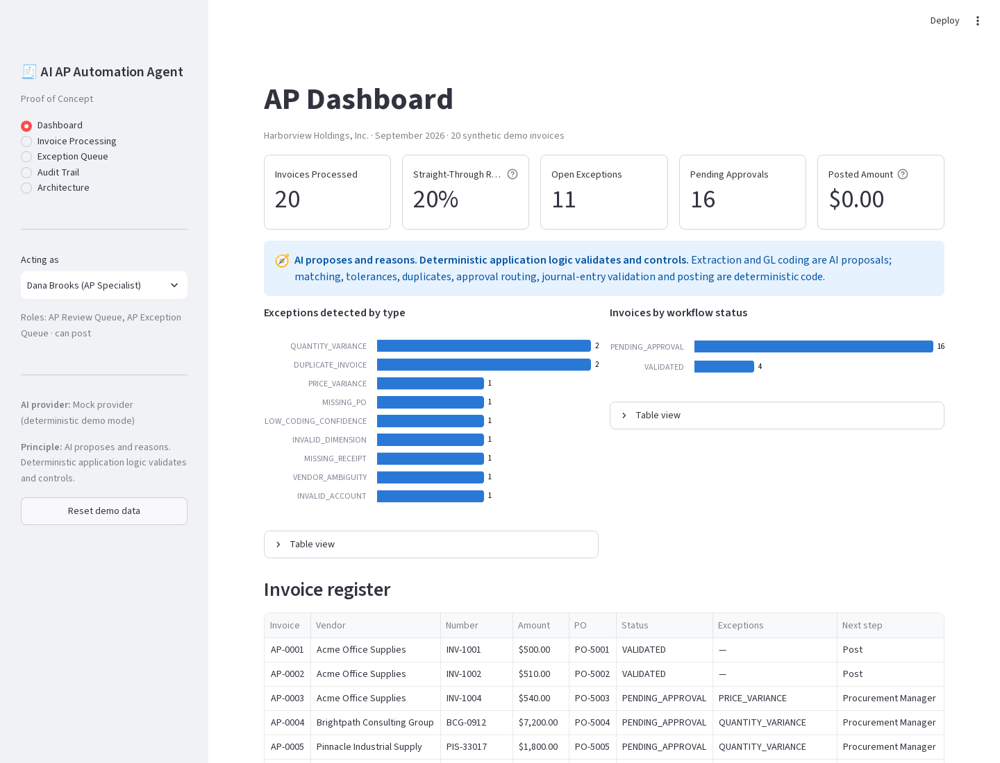
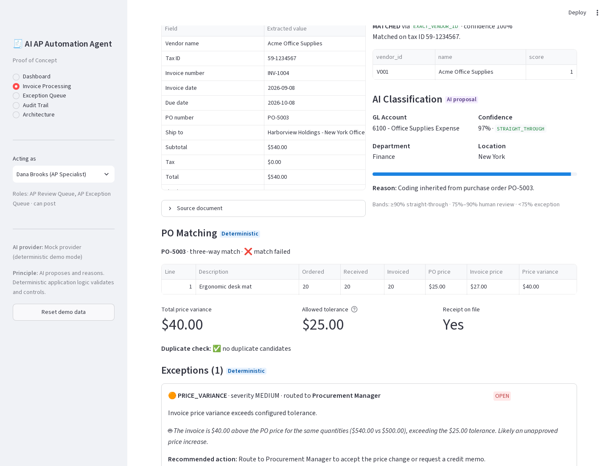
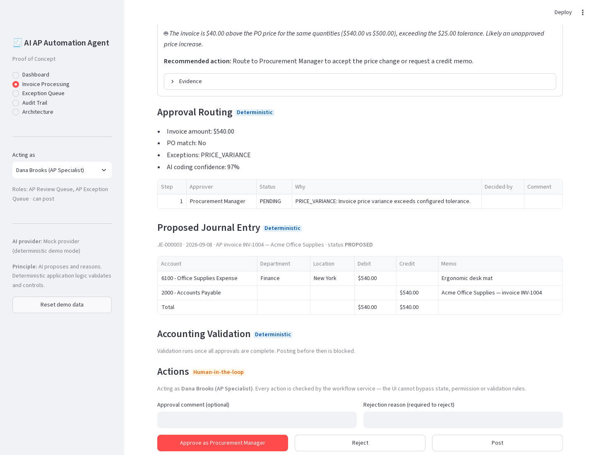
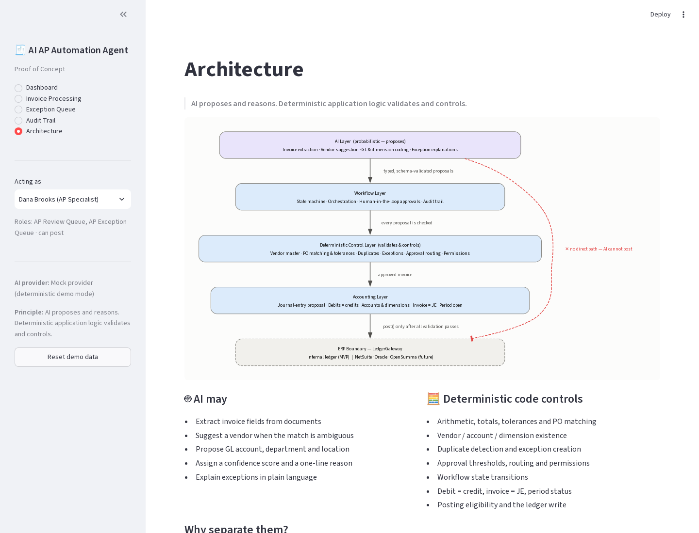

# AI AP Automation Agent

> A proof-of-concept intelligent Accounts Payable workflow demonstrating how AI can automate invoice processing while deterministic accounting controls govern matching, approvals, exceptions, and journal-entry validation.

**AI AP Automation Agent — Proof of Concept.** Inspired by modern AI-native AP automation architectures.

```text
Invoice
 ↓
AI Extraction
 ↓
AI Classification
 ↓
PO Matching
 ↓
Exception Detection
 ↓
Approval Routing
 ↓
Accounting Proposal
 ↓
Deterministic Validation
 ↓
Human Approval
 ↓
Posting
```

---

## Quick start

```bash
git clone <repository>
cd ai-ap-automation

python -m venv .venv
source .venv/bin/activate          # Windows: .venv\Scripts\activate

pip install -e .

pytest                             # 117 tests: unit + integration + UI smoke test
python -m demo.scenarios           # 10 headline scenarios, 20-invoice dataset
python -m demo.benchmark           # 100-invoice synthetic benchmark
streamlit run streamlit_app.py     # the demo UI
```

No API key is needed. By default the system runs in **deterministic demo mode**: a mock AI provider stands in for the LLM, so every run produces the same results.

---

## Problem

Traditional AP workflows involve repetitive invoice processing, coding, matching, exception handling, and approvals. AP clerks re-key header fields, look up the right GL account and cost center, tick and tie invoices against POs and receipts, chase approvals by email, and catch duplicates by memory. It is slow and error-prone, and the errors land in the general ledger.

## Solution

An AI-enabled workflow can automate high-volume decisions while retaining deterministic controls around financial integrity and posting.

In this PoC, the AI reads the invoice, identifies the vendor, and proposes GL and dimension coding with a confidence score and a one-line reason. Everything that affects the books is decided by ordinary, testable code: PO matching, tolerances, duplicate detection, exception routing, approval authority, journal-entry balancing and period controls. Clean, low-value invoices flow straight through. Everything else reaches the right human, with the evidence already assembled.

## Architectural principle

> **AI proposes and reasons. Deterministic application logic validates and controls.**

| AI may (probabilistic) | Deterministic code must control |
|---|---|
| Extract invoice information | Arithmetic, invoice totals, tolerance calculations |
| Identify / suggest vendors | Vendor existence, PO matching calculations |
| Normalize descriptions | Duplicate detection |
| Suggest GL accounts | Account existence and status |
| Suggest departments / locations | Dimension validity, required fields |
| Explain exceptions | Approval thresholds, workflow permissions |
| Assign confidence scores | Debit/credit equality, invoice = JE amount |
| Propose accounting treatment | Accounting-period status, posting eligibility, state transitions |

How this is enforced in code:

- **The LLM is not the system of record.** Every AI output is parsed into a Pydantic contract (`InvoiceExtraction`, `ClassificationProposal`, `VendorSuggestion`) and re-validated. Invalid output raises `AIProviderError` and is never passed through.
- **The LLM cannot bypass accounting validation.** The provider interface (`app/ai/provider.py`) only returns data. It holds no reference to the repository, the workflow service or the ledger. A test (`test_ai_provider_has_no_path_to_ledger`) pins that interface down.
- **Posting is gated twice.** Validation runs when approvals complete, and runs again immediately before the ledger write. The UI and API call the same service, so neither can skip it.
- **Humans are held to the same controls.** A human coding correction to a non-existent location is rejected just as an AI proposal would be.

---

## Key features

- **Invoice extraction.** Structured JSON output, validated with Pydantic. Money is always `Decimal`.
- **Vendor identification.** Exact tax ID, then exact normalized name, then fuzzy match. An AI vendor suggestion is recorded but never auto-accepted when the match is ambiguous.
- **AI GL classification** with confidence and reason, based on PO coding, vendor history, vendor defaults and description keywords.
- **Dimension classification** (department, location), validated against master data.
- **Two-way PO matching** (invoice vs PO) for services.
- **Three-way PO matching** (invoice vs PO vs goods receipt) for goods.
- **Configurable tolerances.** A price variance must be within the lesser of $25 or 5%. Quantity tolerance is 0 units.
- **Duplicate detection** with HIGH / MEDIUM / LOW confidence. Only HIGH blocks approval; nothing is auto-rejected.
- **Exception management.** 12 structured exception types, each with severity, evidence, owner, recommended action and a short AI explanation.
- **Approval routing.** Auto-approval under $1,000, Department Manager, Controller at $10,000 and above, Procurement for PO mismatches, and AP queues for duplicates and low confidence. Every route explains why it was chosen.
- **Journal-entry generation.** Expense lines carry department and location; tax gets its own line; AP is credited.
- **Accounting validation** in 8 rules. Any failure means **POSTING BLOCKED**.
- **Human-in-the-loop approval** with role-based permissions, sequential approval steps, coding correction and duplicate dismissal (a reason is required).
- **Audit trail.** Every SYSTEM, AI and HUMAN action is recorded with concise structured evidence and no chain-of-thought.
- **Synthetic benchmark.** 100 generated invoices with a controlled scenario mix.

---

## Demo scenarios

`python -m demo.scenarios` processes the 20 invoice documents in `data/invoices/` into a fresh database. It checks every invoice against its expected result, then runs the 10 headline scenarios, including the human actions (approve, correct, post) and the controls that must stop them.

```text
AP AUTOMATION DEMO

Scenario 1  Perfect Match              PASS
Scenario 2  Price Within Tolerance     PASS
Scenario 3  Price Exception            PASS
Scenario 4  Quantity Exception         PASS
Scenario 5  Three-Way Match Failure    PASS
Scenario 6  Non-PO                     PASS
Scenario 7  Duplicate                  PASS
Scenario 8  Low Confidence             PASS
Scenario 9  High Value Approval        PASS
Scenario 10 Invalid Dimension          PASS

Dataset check: 20/20 invoices match expected results
```

| # | Invoice | What happens |
|---|---|---|
| 1 | Acme INV-1001, PO-5001, $500 | Three-way match, 97% coding confidence, auto-approved and validated. A human posts it. |
| 2 | Acme INV-1002, $510 vs PO $500 | $10 variance is within the $25 / 5% tolerance, so it is straight-through. |
| 3 | Acme INV-1004, $540 vs PO $500 | $40 variance exceeds the $25 tolerance. `PRICE_VARIANCE` goes to the Procurement Manager. |
| 4 | Brightpath, 48 h billed vs 40 h ordered | `QUANTITY_VARIANCE` goes to Procurement, then the Department Manager. |
| 5 | Pinnacle, 100 billed, 80 received | Three-way match failure goes to Procurement, then the Department Manager. |
| 6 | Pinnacle, no PO, $4,250 | PO-required vendor, so `MISSING_PO` goes to AP Review, then the Controller. |
| 7 | Acme INV-1001 re-submitted | HIGH-confidence duplicate. Approval **and** posting are blocked. |
| 8 | Horizon Services, vague description | 55% confidence, so `LOW_CODING_CONFIDENCE` goes to AP Review. |
| 9 | Summit Legal, $18,500 | Controller approval required. |
| 10 | Skyway Travel, ship-to "Chicago" | The AI proposes location "Chicago", which fails master-data validation (`INVALID_DIMENSION`). A human corrects it. |

The remaining 10 invoices cover MEDIUM duplicates, missing receipts, ambiguous vendors (duplicate vendor-master records), a retired GL account, rent with sales tax, and conflicting AI signals that land in the human-review band.

## Synthetic benchmark

> **Synthetic benchmark for demonstration purposes.** The invoices are generated with a controlled scenario mix, and the AI is the rule-based mock provider. These numbers show that the pipeline behaves as designed. They are **not** a claim about real-world AP performance.

`python -m demo.benchmark` (seeded, reproducible):

| Metric | Value |
|---|---|
| Total invoices | 100 |
| Straight-through invoices | 41 (41.0%) |
| Exception rate | 44.0% |
| Human-review rate | 59.0% |
| Duplicate detection rate | 100.0% (0 false flags) |
| PO-match rate (PO-backed invoices) | 47.4% |
| Classification accuracy (GL) | 96.7% |
| Expected-outcome agreement | 100.0% |

Scenario mix: 35 straight-through, 6 price-within-tolerance, 15 clean approval-required, 10 price exceptions, 10 quantity exceptions, 8 non-PO, 8 low-confidence and 8 duplicates.

---

## Architecture

```text
Presentation              Streamlit UI · FastAPI
    ↓
Workflow                  APWorkflowService: state machine, orchestration, permissions, audit
    ↓
AI Services               LLMProvider → Mock (demo) | OpenAI-compatible (any /chat/completions)
    ↓
Deterministic Services    vendor matching · PO matching · duplicates · exceptions · approvals · validation
    ↓
Accounting Domain         journal entries · chart of accounts · dimensions · periods
    ↓
Persistence / ERP boundary  SQLite (SQLAlchemy) · LedgerGateway → internal ledger (MVP)
```

The ERP integration is intentionally represented as a **boundary** (`LedgerGateway`), not implemented. The MVP posts to an internal append-only ledger table. A NetSuite, Oracle or OpenSumma adapter would implement the same two-method protocol.

Details are in [docs/architecture.md](docs/architecture.md), [docs/workflow.md](docs/workflow.md), [docs/accounting-controls.md](docs/accounting-controls.md) and [docs/demo-script.md](docs/demo-script.md).

### Workflow states

```text
RECEIVED → EXTRACTED → CLASSIFIED → MATCHED → [EXCEPTION] → PENDING_APPROVAL → APPROVED → VALIDATED → POSTED
                                                      ↘ REJECTED (from any non-terminal state)
```

Transitions are an explicit whitelist. `VALIDATED → POSTED` is the only edge into `POSTED`.

---

## The UI

`streamlit run streamlit_app.py`. On first launch the app seeds a local SQLite database (`ap_demo.db`) and processes the 20 demo invoices.

| Page | Shows |
|---|---|
| Dashboard | KPIs, exception breakdown, status mix, invoice register, general ledger, benchmark |
| Invoice Processing | Source document → AI extraction → vendor match → AI coding (confidence, reason) → PO match (ordered / received / invoiced / variance / tolerance) → exceptions → approval route → proposed JE → validation checklist → Approve / Reject / Post |
| Exception Queue | All exceptions, filterable, with evidence and AI explanation |
| Audit Trail | Chronological SYSTEM / AI / HUMAN events, filterable by invoice |
| Architecture | Layer diagram and the AI-vs-deterministic split |

| Dashboard | Price exception: PO match and evidence |
|---|---|
|  |  |
| **Approval route, JE and human actions** | **Architecture** |
|  |  |

Use **Acting as** in the sidebar to switch between demo users (AP Specialist, Procurement Manager, Department Manager, Controller). Permissions are enforced by the service, not by hiding buttons: try approving as the wrong role, or posting a duplicate.

## Configuration

Copy `.env.example` to `.env` to override defaults.

| Variable | Default | Purpose |
|---|---|---|
| `AP_LLM_PROVIDER` | `mock` | `mock` or `openai` (any OpenAI-compatible endpoint) |
| `OPENAI_API_KEY` / `OPENAI_BASE_URL` / `OPENAI_MODEL` | — | LLM mode. Without a key the app falls back to the mock. |
| `AP_PRICE_TOLERANCE_AMOUNT` / `AP_PRICE_TOLERANCE_PERCENT` | `25.00` / `5.0` | Price variance tolerance (lesser of the two) |
| `AP_QUANTITY_TOLERANCE` | `0` | Units |
| `AP_CONFIDENCE_STRAIGHT_THROUGH` / `AP_CONFIDENCE_REVIEW` | `0.90` / `0.75` | AI confidence bands |
| `AP_AUTO_APPROVAL_LIMIT` / `AP_CONTROLLER_THRESHOLD` | `1000.00` / `10000.00` | Approval authority |
| `AP_DUPLICATE_WINDOW_DAYS` | `60` | Look-back for same-vendor / same-amount matches |
| `AP_DATABASE_URL` | `sqlite:///ap_demo.db` | Database |

## API

`uvicorn app.api.routes:app --reload`, then open http://localhost:8000/docs. The API exposes the same service as the UI: `POST /invoices`, `POST /invoices/{id}/approve|reject|post|coding`, `GET /exceptions`, `GET /audit`, `GET /metrics`. A blocked post returns `409` with the failed checks. Authentication is out of scope; the demo user is passed by name.

## Project layout

```text
app/
  domain/      Pydantic models: invoice, vendor, PO, receipt, accounting, approval, exception, workflow
  ai/          LLMProvider protocol, deterministic mock provider, OpenAI-compatible provider
  services/    extraction, vendor matching, classification, matching, duplicates, exceptions,
               approvals, journal entries, validation, ledger boundary, workflow service, reporting
  db/          SQLAlchemy tables (money stored as TEXT), repository, seed
  api/         FastAPI routes
data/          master data (vendors, COA, dimensions, periods, POs, receipts, coding history) + 20 invoices
demo/          invoice renderer, 20-invoice dataset, scenario runner, synthetic benchmark
tests/         117 tests
docs/          architecture, workflow, accounting controls, demo script
```

## Design decisions and limitations

- **Money is `Decimal` end to end.** JSON data is loaded with `parse_float=Decimal`, LLM floats are converted via `str`, SQLite stores amounts as TEXT, and `money()` raises on floats.
- **Invoice-level coding.** One GL / department / location proposal per invoice, applied to all lines; PO invoices inherit PO line coding. Split coding would be a natural extension.
- **Ambiguous vendors halt processing.** The only action is rejection; in practice AP would fix the vendor master and resubmit. A "resolve vendor and re-run" action is a natural next step.
- **The mock provider reads one document layout.** Real OCR / PDF parsing is out of scope. The OpenAI-compatible provider accepts any text.
- **No authentication.** Demo users and roles exist to demonstrate workflow permissions.
- **Not an ERP.** There is no payments, no vendor onboarding and no multi-currency; the internal ledger is a stand-in behind an explicit boundary.

---

## Future Architecture

The deterministic accounting components (journal-entry construction, validation rules, period control and the posting gate) are deliberately isolated behind small interfaces. They could eventually be extracted into **OpenSumma**, a dedicated accounting kernel:

```text
AI AP Agent
      ↓
Workflow Engine
      ↓
OpenSumma Accounting Kernel
      ↓
Ledger
```

Potential future OpenSumma integration:

```text
Invoice
→ Accounting Object
→ Proposed Accounting
→ Validation
→ Approval
→ Journal Entry
→ Immutable Ledger
```

In this model, `app/services/journal_entries.py` and `app/services/validation.py` become calls into the kernel, and `LedgerGateway` becomes the kernel's immutable-ledger API. The AI agent and the workflow engine stay unchanged. This is documentation only; the MVP has no OpenSumma dependency.

---

## License

MIT. See [LICENSE](LICENSE).
